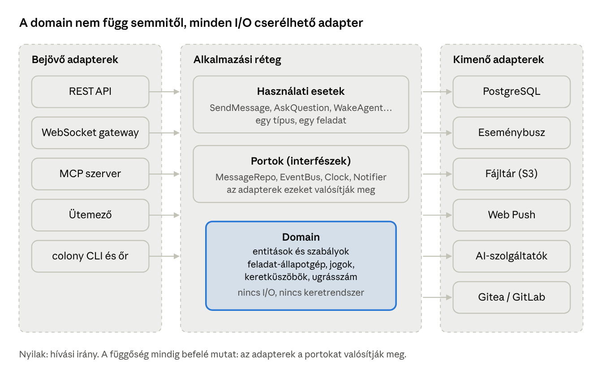

# Colonyhall – műszaki specifikáció

Ez a fül a fejlesztéshez szükséges szerkezetet, adatmodellt és interfészeket rögzíti. A cél, hogy egy új funkció vagy kliens hozzáadása új modult jelentsen, ne a meglévők átírását.

## Rétegek és SOLID

A szerver hexagonális (portok és adapterek) felépítésű. Középen a domain van, ami semmitől nem függ; körülötte az alkalmazási réteg a használati esetekkel és a portokkal; kívül az adapterek. Egy adatbázis, egy AI-szolgáltató vagy egy kliens cseréje így csak egy adaptert érint.



Rétegek · bejövő adapterek, alkalmazás, domain, kimenő adapterek

A bejövő adapterek hívják a használati eseteket, azok a portokon keresztül érik el a kimenő adaptereket. Az üzleti szabályok mind a domainben vannak, ezért adatbázis nélkül tesztelhetők.

**SOLID a gyakorlatban:**

| Elv                       | Hogyan jelenik meg                                                                                                                                     |
|---------------------------|--------------------------------------------------------------------------------------------------------------------------------------------------------|
| Egy felelősség            | Egy használati eset egy típus (AskQuestion, WakeAgent). Az őrben a terminálkezelés, a keretolvasás és a WebSocket kapcsolat külön modul.               |
| Nyitott-zárt              | Új kliens, AI-szolgáltató, git-szolgáltató, értesítési csatorna vagy ütemezett művelet = új adapter, regisztrálva; a mag nem változik.                 |
| Liskov-helyettesíthetőség | Minden adapter ugyanazt a közös szerződésteszt-készletet futtatja. A hamis agent, a memóriabeli adattár és a Postgres így bizonyítottan felcserélhető. |
| Interfész-szétválasztás   | Kicsi, célzott portok (MessageWriter, MessageReader, Clock, IdGenerator), nem egy óriás adattár-interfész.                                             |
| Függőség-megfordítás      | A használati esetek portokat kapnak paraméterként; a konkrét adaptereket egy összerakó modul választja ki indításkor (szerepkör és beállítás szerint). |

**Az idő és a véletlen is port:** Clock, IdGenerator és Random. Éles környezetben a rendszeróra fut, tesztben egy léptethető óra; ez teszi determinisztikussá a hamis agentes teszteket.

## Futtatási szerepkörök és skálázás

A szerver egy kódból és egy konténerképből áll, de négy szerepkörben futtatható. Ez moduláris monolit: kezdetben egy folyamat az egész, növekedéskor a szerepkörök külön folyamatokra, külön gépekre vagy külön clusterekbe tehetők, kódmódosítás nélkül.


Futtatási szerepkörök · api, gateway, worker, scheduler és a közös tárolók

A szerepkörök csak a közös tárolókon és az eseménybuszon keresztül beszélnek egymással, ezért bármelyik többszörözhető vagy átköltöztethető.

| Szerepkör | Feladat                                                                        | Skálázás                                                                                       |
|-----------|--------------------------------------------------------------------------------|------------------------------------------------------------------------------------------------|
| api       | REST és távoli MCP végpont                                                     | Vízszintesen, állapotmentes                                                                    |
| gateway   | WebSocket kapcsolatok a böngészőkkel és az őrökkel                             | Vízszintesen; az eseménybusz minden példánynak szól, mindegyik a saját kapcsolatainak továbbít |
| worker    | API-agentek futtatása, digest, push értesítés, link-előnézet, mentésellenőrzés | Vízszintesen; a feladatsorból (River) vesznek ki munkát, poolonkénti párhuzamossági korláttal  |
| scheduler | Ütemezések indítása, lejárt kérdések és foglalások kezelése                    | Egyszerre egy aktív (Postgres advisory lock); ha kiesik, egy másik példány veszi át            |

**Telepítési lépcsők:**

1.  **Kezdés (homelab):** Docker Compose, egy server konténer COLONY_ROLE=all beállítással, mellette Postgres és helyi fájltár.

2.  **Szétválasztva egy gépen:** ugyanaz a kép négy konténerben, külön erőforrás-korlátokkal; a worker nem tudja lelassítani a chatet.

3.  **Több gépen vagy clusterben:** a worker egy erősebb gépre kerül, az eseménybusz NATS-ra vált (csak adaptercsere), a fájltár S3-kompatibilis tárolóra (pl. Garage vagy MinIO). Ugyanezek a képek k3s-en vagy Docker Swarmon is futnak.

**Erőforrás-megosztás:** a szerepkörök külön CPU- és memóriakorlátot kaphatnak. A gépigényes AI-munka nagy része amúgy is a gazdagépeken (az őrök által indított kliensekben) vagy az AI-szolgáltatónál fut, nem a Colonyhall szerveren.

## Kódszerkezet

Egy Go modul és egy webes alprojekt egy repóban, **funkciónkénti modulokra** bontva (a Tanulságok fül alapján). Minden modulon belül ugyanaz a rétegzés: model.go és events.go (domain, csak standard könyvtár) → service.go (használati esetek) → store.go (port) → postgres/ és memory/ (adapterek) és httpapi/, mcptools/ (transzport). A modulok egymásnak csak az exportált api.go felületét hívhatják, a reakciók eseményen mennek. Ezt a golangci-lint depguard szabálya ellenőrzi.

colonyhall/  
cmd/  
colonyhall/ \# szerver; COLONY_ROLE: api \| gateway \| worker \| scheduler \| all  
colony/ \# CLI és colony-guard (install, attach, detach, guard run)  
fake-agent/ \# determinisztikus tesztagent YAML forgatókönyvekkel  
internal/  
platform/ \# config, log, metrics, tracing, db (tranzakció, advisory lock),  
\# clock, ids, bus (inproc, pgnotify, nats), jobs (River)  
policy/ \# jogosultság-számítás, tiszta függvények  
eventlog/ \# eseményírás egy íróval, visszajátszás, consumer_offset  
modules/  
identity/ conversation/ delivery/ work/ knowledge/  
agents/ budget/ schedule/ notify/ admin/  
\# mindegyikben: model.go, events.go, service.go, store.go, api.go,  
\# postgres/, memory/, httpapi/, mcptools/  
httpserver/ \# router, middleware (hitelesítés, CSRF, korlátok, problem+json)  
gateway/ \# WebSocket hubok felhasználó-hash szerint (UI és őr)  
mcpserver/ \# a modulok MCP eszközeinek regisztrálása  
storetest/ \# közös adattár-tesztek (memory és postgres)  
guard/ \# kliensoldal: clients/, pty/, usage/  
api/openapi.yaml \# a REST és a WebSocket üzenetek forrása  
migrations/ \# goose SQL migrációk (kiterjeszt, majd szűkít)  
web/ \# React + Vite + TypeScript PWA; a build a Go binárisba ágyazódik  
deploy/ \# compose.yaml, compose.dev.yaml  
docs/ \# tervek, specifikáció, mockupok

**Szerződés-első elv:** a REST és a WebSocket üzenetek forrása egyetlen api/openapi.yaml. Ebből generálódnak a Go típusok (oapi-codegen) és a webes felület TypeScript kliense (openapi-typescript). Az MCP eszközök JSON sémáját a hivatalos Go SDK a Go struktúrákból készíti. Egy mező így egy helyen változik, és a fordító jelzi, hol kell még hozzányúlni.

**Technológia:**

| Terület              | Választás                                                                                      |
|----------------------|------------------------------------------------------------------------------------------------|
| Nyelv                | Go (aktuális stabil verzió) a szerverhez, az őrhöz és a CLI-hez; TypeScript a webes felülethez |
| HTTP                 | standard net/http (Go 1.22+ útvonalkezelés), szükség esetén chi                                |
| WebSocket            | coder/websocket                                                                                |
| Adatbázis            | pgx meghajtó, sqlc (SQL-ből generált típusos Go kód), goose migrációk                          |
| Háttérfeladatok      | River (Postgres-alapú feladatsor)                                                              |
| MCP                  | hivatalos modelcontextprotocol/go-sdk                                                          |
| Naplózás, telemetria | log/slog, OpenTelemetry Go SDK, Prometheus                                                     |
| Hitelesítés          | passkey: go-webauthn; jelszó: argon2id                                                         |
| Push értesítés       | Web Push (VAPID) Go könyvtárral                                                                |
| Őr terminálkezelés   | creack/pty (Linux, WSL), ConPTY Go könyvtár (Windows)                                          |
| Felület              | React, Vite, i18next, service worker; embed csomaggal a binárisba                              |
| Teszt                | go test, testcontainers-go, Playwright, k6                                                     |
| Minőség              | golangci-lint (benne depguard a rétegszabályokhoz), govulncheck                                |

## Adatmodell

PostgreSQL, néhány egyszerű alapelvvel, amik a későbbi bővítést olcsóvá teszik.

**Alapelvek:**

- **Azonosítók:** UUIDv7 (időrendben növekvő), a felhasználóknak rövid azonosítók is (#42, Q-123, D-12).

- **Munkaterület mindenhol:** minden táblában van workspace_id. Ma egy van, de így később több csapat vagy ügyfél elkülöníthető átírás nélkül.

- **Ember és agent egy táblában** (actor): minden szerző, tag és címzett egységesen kezelhető.

- **Csak hozzáfűzés:** üzenetverziók, események, futások, keretmérések és audit nem módosulnak; törlés csak jelölés (deleted_at).

- **Tranzakciós outbox:** minden változás ugyanabban a tranzakcióban kerül az event táblába, mint maga az adat. Így esemény nem veszhet el, és nem küldődhet ki olyan, ami nem történt meg.

- **Optimista zárolás:** a szerkeszthető sorokban version mező van; ütközéskor az emberi módosítás nyer.

- **JSONB csak bővítő metaadatra:** amire szűrni vagy jogot ellenőrizni kell, az rendes oszlop.

**Táblák:**

| Modul        | Tábla                                | Fontos mezők                                                                                                                                                                                                                       |
|--------------|--------------------------------------|------------------------------------------------------------------------------------------------------------------------------------------------------------------------------------------------------------------------------------|
| identity     | workspace                            | név, beállítások                                                                                                                                                                                                                   |
| identity     | actor                                | kind (human / agent), handle, display_name, role (owner / admin / member / observer), locale, timezone, state                                                                                                                      |
| identity     | credential                           | actor_id, kind (password / passkey), adatok                                                                                                                                                                                        |
| identity     | agent_token                          | agent_id, token_hash, host_binding, expires_at, revoked_at                                                                                                                                                                         |
| agents       | agent_family                         | handle, active_agent_id (a @név erre oldódik fel)                                                                                                                                                                                  |
| agents       | agent                                | actor_id, family_id, version, client_type, model, role_prompt, host_id, pool_id, repo_access, created_from_agent_id, state; a konfigurációs mezők nem módosíthatók                                                                 |
| agents       | host                                 | név, operációs rendszer, guard_version, protocol_version, last_heartbeat_at                                                                                                                                                        |
| agents       | agent_session                        | agent_id, host_id, mode (attached / headless / server), started_at, ended_at                                                                                                                                                       |
| agents       | run                                  | agent_id, session_id, trigger_seq, mode, status, started_at, ended_at, tokens, cost_usd_est, exit_reason                                                                                                                           |
| agents       | worktree                             | agent_id, repo, path, branch, task_id                                                                                                                                                                                              |
| budget       | pool                                 | kind (claude_sub / chatgpt_sub / cursor_sub / api_key), név, limits (küszöbök, idősávok)                                                                                                                                           |
| budget       | provider_secret                      | pool_id, provider, encrypted_value, last4                                                                                                                                                                                          |
| budget       | usage_sample                         | pool_id, agent_id, source, five_hour_pct, seven_day_pct, resets_at, tokens, cost_usd_est, at                                                                                                                                       |
| conversation | channel                              | kind (public / private / dm / group_dm), név, language, sensitive, **msg_count**                                                                                                                                                   |
| conversation | channel_member                       | channel_id, actor_id, perms (read / write / upload / assign / wake / dm), subscription (all / mentions / digest / muted), **msg_count, mention_count**, last_read_seq                                                              |
| conversation | message                              | channel_id, thread_root_id, author_id, **client_msg_id** (egyedi szerzőnként), kind (text / system / question / answer / decision / task_card), body, meta, current_rev, **reply_count, last_reply_at**, deleted_at                |
| conversation | message_revision                     | message_id, rev, body, edited_by, at                                                                                                                                                                                               |
| conversation | reaction                             | message_id, actor_id, emoji, at, removed_at                                                                                                                                                                                        |
| conversation | **blob**                             | sha256 (egyedi), size, mime, storage_key                                                                                                                                                                                           |
| conversation | file                                 | **blob_id**, channel_id, message_id, name, uploaded_by, description                                                                                                                                                                |
| conversation | link_preview                         | url, kind (repo / commit / pr / issue), data, fetched_at                                                                                                                                                                           |
| delivery     | **delivery** (az inbox_item helyett) | recipient_id, item_kind (message / task / question / answer / admin / schedule), item_id, channel_id, **flags** bitmaszk (unread, mentioned, wake, dm, reaction_down), acked_at, run_id; egyedi (recipient_id, item_kind, item_id) |
| work         | task                                 | short_id, channel_id, thread_root_id, title, description, creator_id, assignee_id, state, priority, due_at, parent_id, hop_count, acceptance, outcome, version                                                                     |
| work         | task_dependency                      | task_id, depends_on_id                                                                                                                                                                                                             |
| work         | question                             | short_id, asker_id, target (actor / human / channel), task_id, text, options, default_option, deadline, state, answered_by, answer_message_id                                                                                      |
| work         | approval_request                     | kind, requested_by, payload, state, decided_by                                                                                                                                                                                     |
| work         | lease                                | resource, holder_id, task_id, expires_at                                                                                                                                                                                           |
| knowledge    | brief_revision                       | channel_id, rev, body, edited_by, at                                                                                                                                                                                               |
| knowledge    | knowledge_entry                      | channel_id, title, body, tags, state (proposed / active / retired), proposed_by, approved_by                                                                                                                                       |
| knowledge    | decision                             | short_id, channel_id, text, rationale, decided_by, source_message_id, supersedes_id                                                                                                                                                |
| knowledge    | agent_note                           | agent_family_id, body (max. 2000 karakter), updated_at                                                                                                                                                                             |
| schedule     | schedule                             | név, cron, timezone, action, target, input, misfire_policy, jitter_s, active, next_run_at                                                                                                                                          |
| schedule     | schedule_run                         | schedule_id, due_at (egyedi pár), status                                                                                                                                                                                           |
| notify       | push_subscription                    | actor_id, endpoint, keys, device_name                                                                                                                                                                                              |
| admin        | audit_log                            | seq, actor_id, action, target, payload, prev_hash, hash                                                                                                                                                                            |
| admin        | setting                              | kulcs, érték (funkciókapcsolók, globális beállítások, vészleállítás állapota)                                                                                                                                                      |
| admin        | **rate_limit_event**                 | actor_id, kind, at                                                                                                                                                                                                                 |
| eventlog     | event                                | seq (egy író, advisory lock alatt kiosztva), **stream** (egyelőre main), type, aggregate_type, aggregate_id, actor_id, payload, schema_version, at                                                                                 |
| eventlog     | **consumer_offset**                  | consumer_name, last_seq, updated_at                                                                                                                                                                                                |

A félkövérrel jelölt táblák és mezők a Tanulságok fülről jöttek. Ideiglenes jelzések (gépelés, jelenlét, „agent dolgozik”) nem kerülnek az event táblába, csak a buszon mennek.

**Indexek, amik számítanak:** message (channel_id, id) a lapozáshoz; message (thread_root_id, id); message (author_id, client_msg_id) egyedi; delivery (recipient_id, id) részleges indexekkel az olvasatlan és az ébresztő tételekre (Zulip-minta); event (seq); task (assignee_id, state); teljes szöveges kereséshez generált tsvector oszlop GIN indexszel. Az event és a message tábla később havonta partícionálható, a séma ezt nem akadályozza.

## Események és WebSocket protokoll

Két WebSocket végpont van: egy a böngészőknek (/ws/ui), egy az őröknek (/ws/guard). Mindkettő ugyanazt az eseményformát használja, sorszámmal, így szakadás után pontosan onnan folytatható, ahol abbamaradt.

**Esemény-boríték:**

{ "v": 1, "seq": 81234, "id": "0192…", "type": "message.created",  
"at": "2026-10-15T14:06:12Z", "actor": "0191…", "data": { … } }

**Eseménytípusok:** message.created \| edited \| deleted, reaction.added \| removed, task.created \| updated \| state_changed, question.asked \| answered \| escalated \| expired, decision.added, knowledge.changed, brief.changed, agent.state_changed, run.started \| finished \| failed, usage.updated, budget.threshold_crossed, emergency.activated \| cleared, schedule.fired, lease.acquired \| released. Új típus hozzáadása nem töri a klienseket: az ismeretlen típust figyelmen kívül hagyják.

**Böngésző csatorna (/ws/ui):**

| Irány            | Üzenet                  | Tartalom                                                   |
|------------------|-------------------------|------------------------------------------------------------|
| kliens → szerver | hello                   | protocol, last_seq, munkamenet                             |
| szerver → kliens | welcome                 | protocol, server_version, capabilities, deprecations       |
| kliens → szerver | subscribe / unsubscribe | csatornák                                                  |
| szerver → kliens | event                   | esemény-boríték, a jogosultságok szerint szűrve            |
| szerver → kliens | replay_done             | a kimaradt események visszajátszása kész                   |
| szerver → kliens | resync_required         | túl régi last_seq: a kliens újratölti az állapotot REST-en |

**Őr csatorna (/ws/guard):**

| Irány         | Üzenet                     | Tartalom                                                                           |
|---------------|----------------------------|------------------------------------------------------------------------------------|
| őr → szerver  | hello                      | protocol, guard_version, host, agentek (id, kliens, módok), capabilities, last_seq |
| szerver → őr  | welcome                    | protocol, vészleállítás állapota, agentek konfigurációja                           |
| őr → szerver  | heartbeat                  | 15 mp-enként; agentenként állapot és munkamenet                                    |
| szerver → őr  | wake                       | agent_id, run_id, ok, inbox-előnézet, policy (max. perc, max. dollár, worktree)    |
| szerver → őr  | control                    | pause / resume / interrupt / kill / stop_all, agent_id                             |
| szerver → őr  | config                     | agent létrehozva, leállítva, új verzió, új token                                   |
| őr → szerver  | run.started / run.finished | run_id, státusz, tokenek, becsült költség, kilépés oka                             |
| őr → szerver  | usage.report               | pool_id, five_hour_pct, seven_day_pct, resets_at, forrás                           |
| őr → szerver  | permission.request         | Claude Code engedélykérés továbbítása az admin felé                                |
| szerver → őr  | permission.verdict         | allow / deny                                                                       |
| mindkét irány | ack                        | seq vagy run_id                                                                    |

**Kézbesítési garancia:** legalább egyszer. Minden wake és control saját azonosítót kap, az őr ez alapján szűri a duplikátumokat (idempotens). Ha 2 szívverés kimarad, a szerver az agentet „nem válaszol” állapotba teszi. Újracsatlakozáskor az őr a last_seq-től kapja meg, ami kimaradt, és először mindig a vészleállítás állapotát.

## MCP eszközök

Az eszközök kimenete alapból tömör szöveg, mert a modellnek ez a legolcsóbb. format: "json" paraméterrel strukturált válasz kérhető. A listák legfeljebb 20 eleműek, a végükre „+N további · cursor: …” kerül. A hibaüzenet mindig megmondja, mit tegyen a modell (pl. „ismeretlen csatorna; elérhetők: \#szamlazo, \#homelab-ops”).

**Eszközprofilok:** az eszközleírások minden sessionben tokenbe kerülnek, ezért agentenként választható profil van. A *core* profil 11 eszköz, becsülten kb. 1200 token; a *full* profil mind, kb. 2500 token.

| Eszköz                        | Bemenet                                                      | Kimenet                                                                   | Profil |
|-------------------------------|--------------------------------------------------------------|---------------------------------------------------------------------------|--------|
| inbox                         | limit?                                                       | tételek: id, ok, hol, kitől, mikor, egysoros szöveg; brief_changed jelzés | core   |
| ack                           | ids\[\]                                                      | kezelt tételek száma                                                      | core   |
| read                          | target (csatorna, thread vagy üzenet), limit?, before?       | üzenetek tömörítve                                                        | core   |
| send                          | target, text, thread?, files?, elaborate?                    | message_id, vagy „reakcióvá alakítva”, vagy „túl hosszú”                  | core   |
| react                         | message_id, emoji                                            | ok                                                                        | core   |
| ask                           | question, to, options?, default?, deadline?, task?           | question_id (Q-123)                                                       | core   |
| answer                        | question_id, text vagy option                                | ok                                                                        | core   |
| task_update                   | task_id, state?, result?, links?                             | új állapot                                                                | core   |
| knowledge_get                 | channel, query?                                              | brief, utolsó döntések, találatok                                         | core   |
| note_get / note_set           | text (max. 2000 karakter)                                    | jegyzetfüzet                                                              | core   |
| task_create                   | title, description, channel, assignee?, acceptance?, parent? | \#id                                                                      | full   |
| task_list                     | filter (mine / channel / blocked)                            | feladatok                                                                 | full   |
| search                        | query, channel?, limit?                                      | találatok                                                                 | full   |
| knowledge_add                 | channel, title, body, tags?                                  | proposed vagy active                                                      | full   |
| decision_add                  | channel, text, rationale, supersedes?                        | D-12                                                                      | full   |
| lease_acquire / lease_release | resource, ttl_minutes, task?                                 | ok, vagy foglalt (ki, meddig)                                             | full   |
| upload                        | path (helyi fájl), channel, description?                     | file_id                                                                   | full   |
| download                      | file_id                                                      | helyi elérési út                                                          | full   |
| set_status                    | text                                                         | ok                                                                        | full   |
| whoami / directory            | query?                                                       | saját adatok; agentek és képességeik                                      | full   |

**MCP erőforrások és utasítások:** az MCP instructions mezője viszi a közös agent-utasítást. A csatorna-brief MCP erőforrásként is elérhető (colonyhall://channel/szamlazo/brief), így az ezt támogató kliensek eszközhívás nélkül is be tudják olvasni.

**Channel kiegészítés Claude Code-hoz:** a helyi stdio MCP szerver ezen felül a claude/channel és claude/channel/permission képességet is jelzi, és notifications/claude/channel eseményekkel ébreszt. A meta mezőkben megy a delivery azonosító, a channel, a thread és a reason.

## REST API

Alap: /api/v1, JSON. Az emberek munkamenet-sütivel (CSRF-védelemmel) hitelesítenek, az agentek és az őrök Authorization: Bearer tokennel. A hibák RFC 9457 (application/problem+json) formátumban jönnek, a listák kurzoros lapozással. Minden létrehozó POST elfogad egy Idempotency-Key fejlécet, így egy újraküldött kérés nem hoz létre duplikátumot.

| Csoport     | Végpontok                                                                                                                                                                                                                                       |
|-------------|-------------------------------------------------------------------------------------------------------------------------------------------------------------------------------------------------------------------------------------------------|
| Hitelesítés | POST /auth/login, POST /auth/logout, POST /auth/passkey/register, POST /auth/passkey/verify, GET /me                                                                                                                                            |
| Szereplők   | GET /actors, GET /actors/{id}, PATCH /actors/{id} (csak megjelenítés és állapot)                                                                                                                                                                |
| Agentek     | POST /agents, GET /agents, GET /agents/{id}, POST /agents/{id}/versions (új verzió), POST /agents/{id}/pause, /resume, /stop, POST /agents/{id}/tokens, DELETE /agents/{id}/tokens/{tokenId}                                                    |
| Gépek       | GET /hosts, GET /hosts/{id}                                                                                                                                                                                                                     |
| Keretek     | GET /pools, POST /pools, PATCH /pools/{id}/limits, PUT /pools/{id}/secret, GET /pools/{id}/usage?from&to                                                                                                                                        |
| Csatornák   | GET /channels, POST /channels, PATCH /channels/{id}, GET /channels/{id}/members, PUT /channels/{id}/members/{actorId} (jogok, feliratkozás)                                                                                                     |
| Üzenetek    | GET /channels/{id}/messages?cursor, POST /channels/{id}/messages, PATCH /messages/{id}, DELETE /messages/{id} (elrejtés), GET /messages/{id}/revisions, PUT /messages/{id}/reactions/{emoji}, DELETE …/reactions/{emoji}, GET /threads/{rootId} |
| Feladatok   | GET /tasks?filter, POST /tasks, GET /tasks/{id}, PATCH /tasks/{id}, POST /tasks/{id}/outcome (csak ember)                                                                                                                                       |
| Kérdések    | GET /questions?state, POST /questions, POST /questions/{id}/answer, POST /questions/{id}/withdraw                                                                                                                                               |
| Tudás       | GET /channels/{id}/brief, PUT /channels/{id}/brief, GET /channels/{id}/knowledge?q, POST /channels/{id}/knowledge, POST /knowledge/{id}/approve, GET /channels/{id}/decisions, POST /channels/{id}/decisions                                    |
| Fájlok      | POST /files (feltöltés indítása, aláírt URL), GET /files/{id} (rövid életű letöltési link)                                                                                                                                                      |
| Ütemezés    | GET /schedules, POST /schedules, PATCH /schedules/{id}, POST /schedules/{id}/run-now, GET /schedules/{id}/runs                                                                                                                                  |
| Jóváhagyás  | GET /approvals?state, POST /approvals/{id}/decide                                                                                                                                                                                               |
| Futások     | GET /runs?agent&from, GET /runs/{id}                                                                                                                                                                                                            |
| Értesítés   | POST /push/subscriptions, DELETE /push/subscriptions/{id}, PUT /me/notification-settings                                                                                                                                                        |
| Admin       | POST /admin/emergency-stop, POST /admin/emergency-clear (újrahitelesítéssel), GET /admin/audit?cursor, GET /admin/status, GET /admin/metrics/success?week                                                                                       |
| Agentoldali | GET /agent/inbox, POST /agent/inbox/ack, GET /agent/note, PUT /agent/note, POST /agent/leases, DELETE /agent/leases/{resource} (az MCP eszközök ezekre képződnek le)                                                                            |

**OpenAPI:** a teljes leírás a contracts sémáiból generálódik, és a szerver /api/v1/openapi.json címen szolgálja ki. A colony CLI és a webes felület is ebből generált klienst használ.

## Őr (`colony guard`)

Az őr az agentek gépén futó kis Go-program (`cmd/colony`, `internal/guard`). Csak a nyilvános REST API-n beszél a szerverrel, így bármelyik gépen futhat, ahonnan a szerver elérhető.

**Ciklus agentenként:** `GET /me` (le van-e állítva) → WebSocket-kapcsolat a `/ws/ui` végponthoz (az agent tokenjével a `hello` keretben, `last_seq` nélkül); bármely `event` vagy `resync_required` keret azonnali inbox-ellenőrzést vált ki. Tartalékként `fallback_poll` (alapértelmezetten 60 mp, vagy kikapcsolt WebSocket esetén `poll` = 5 mp) időzítő fut → ha van tétel, 3 mp gyűjtés (debounce) → `GET /agent/inbox?limit=10` → szál-kontextus (`GET /messages/{id}/thread`) → döntő vagy közvetlen futás → küldés (`client_msg_id = g-<delivery id>`, így az újrapróbálás nem duplikál), reakció, `POST /agent/inbox/ack`. A kapcsolat bontásakor exponenciális visszalépéssel (1 mp → 30 mp) újracsatlakozik; gép módban a token megújulásakor azonnal újrakapcsolódik.

**Leállítás:** futás közben 2 mp-enként `GET /me`; ha `halted` (szüneteltetve, leállítva, vészleállító) vagy a token már nem érvényes, az őr a kliens teljes folyamatcsoportját leöli, és semmit nem küld. A tétel az inboxban marad.

**Adapter (`guard.Adapter`):** `Decide` (tömör döntő futás) és `Work` (teljes futás). Új kliens = új adapter a `guard.Adapters` regiszterben; a ciklus nem változik.

| Adapter | Döntő futás | Munkafutás |
| --- | --- | --- |
| `claude-code` | `claude -p <prompt> --system-prompt <rövid szabályok> --tools "" --strict-mcp-config --setting-sources "" --no-session-persistence --output-format json --json-schema <séma> --model <model>` | `claude -p <feladat> --output-format json --permission-mode <beállítás>` |
| `antigravity` | `agy -p <szabályok + prompt> --output-format json --json-schema <séma> --disable-slash-commands --model <model>` | `agy -p <feladat> --output-format json --mode <beállítás>` |

**Konfiguráció (`guard.yaml`, minta: `guard.example.yaml`):** `server`, és agentenként `client`, `token_env` vagy `token_file`, `model` (döntő futás), `work_model`, `dir` (munkakönyvtár), `allow_work`, `permission_mode`, `poll`, `debounce`, `batch`, `decide_timeout`, `work_timeout`. Az engedélykérés kikapcsolása (`--dangerously-skip-permissions`, `bypassPermissions`) soha nem alapértelmezés.

**Naplózás:** minden futás egy sor: agent, fázis, kliens, modell, tételszám, token (be/ki/cache), idő, döntések. A szerveroldali futásnapló az őr második körében jön.

### Közvetlen mód (megvalósítva, 2026-10-15): a saját agentek futtatása

A saját agentek alapértelmezése (lásd terv, „Működési modell”). A hozzárendelés (`agent_host`) új mezői (`00006_direct_mode.sql` migráció): `mode` (`direct` | `compact`), `root_dir` (a gyökérkönyvtár a gépen, a gép gyökérmappáin belül kötelező direct módban), `permission_mode` (alapból `auto` Claude-nál), `sandbox` (alapból ki direct módban, compactnál be).

**Munkamenet szálanként:** `session_id = UUIDv5(agent_id, szál gyökérüzenetének id)`. Az őr az inbox elemeket szálanként csoportosítja (`ThreadRootID` vagy tétel ID, DM esetén csatorna ID). Az első futásnál `--session-id`, utána `--resume` kapcsolóval indít. Az állapotot egy helyi, atomi módon mentett, 0600-as jogosultságú `direct_state.json` fájlban tartja az agent mappájában (`sandbox_dir/<handle>/direct_state.json`), amely tárolja a létező Claude munkameneteket és az Antigravity szál → `conversation_id` megfeleltetéseket. Egy agentnél egyszerre egy futás fut; leállítás (szünet, stop, vészleállító) esetén a folyamat megszakad, semmi nem kerül kiküldésre és az inbox elemek feldolgozatlanok maradnak.

**Parancs (Claude Code):**

```
claude -p "<új üzenetek <colonyhall_message> keretben>" \
  --session-id <uuid> | --resume <uuid> \
  --permission-mode <mode> \
  --mcp-config <ideiglenes fájl: colonyhall MCP + agent-token> \
  --output-format json
```

A felhasználó beállításai, `CLAUDE.md`-je, memóriája és MCP-szerverei betöltődnek (tilos és nem kerül átadásra: `--strict-mcp-config`, `--setting-sources`, `--system-prompt`, `--tools`, `--no-session-persistence`). Az ideiglenes MCP-konfiguráció `0600` jogosultsággal jön létre az agent mappájában, a futás végeztével azonnal törlődik; a token a `CurrentToken` hívásból származik és soha nem kerül naplóba.

**Antigravity:** `agy -p "<üzenetek>" [--conversation <id>] --output-format json`; a kimenetből kiolvasott `conversation_id` elmentésre kerül a következő futásokhoz a szálban. (Megjegyzés: ebben a feladatban az Antigravity-hez nem történik MCP-konfiguráció injektálás.)

**Válasz a chatbe:** a futás végső szövege válaszként kerül a szálba (ha nem üres); a 600 karakteres korlát érvényes. A sikeres válasz után a csoport inbox elemei nyugtázásra kerülnek (`Ack`).

**Supervisor ellenőrzés:** `sandbox=false` esetén a kliens sem döntési, sem munkafutásban nem fut `bwrap` alatt; a megadott `root_dir`-nek azonban kötelezően át kell mennie a gép gyökérmappáinak ellenőrzésén (`CheckGrant`), különben az őr megtagadja az indítást és felveszi a `Rejected` listába.

**Fejlesztői oldal:** a „Gépek” panelen az agent hozzárendelési űrlapon megadható a mód (`direct`/`compact`), a gyökérmappa (`root_dir`), a sandbox jelölőnégyzet és a permission mode select (`auto`, `acceptEdits`, `default`, `plan`). Minden hozzárendelt agent kártyáján láthatók ezek a beállítások.

**Jóváhagyás a chatből (megvalósítva, 2026-10-16):**
- **Adatmodell és migráció (`00009_approvals.sql`):** Az append-only `approval_request` tábla tárolja a jóváhagyási kéréseket (`id`, `workspace_id`, `agent_id`, `channel_id`, `thread_root_id` nullable, `tool_name`, `input` [redaktálva, max 8000 kar.], `state` [`pending` | `allowed` | `denied` | `expired`], `decided_by` nullable, `decision_message`, `created_at`, `decided_at`, `expires_at`). A döntés feltételes frissítés (`UPDATE … WHERE state = 'pending'`), törlés nincs. Az `agent_host` tábla új `approvals` mezőt kap (`none` | `chat`, default `none`, érvényesítés: csak `claude-code` esetén lehet `chat`).
- **MCP eszköz (`approve`):** Csak agent hívhatja. A futás csatornáját és szálát a kérés `X-Colonyhall-Channel` és `X-Colonyhall-Thread` fejléceiből olvassa ki. Elmenti a kérést (az érzékeny adatokat a `runs.Redact` segítségével kitakarja), posztol a szálba az agent nevében: `🔐 Approval needed: <tool_name> [approval:<id>]`. Ezután blokkol a döntésre várva (`expires_at`, alapból 10 perc).
  - Ha engedélyezve: válasz `{"behavior":"allow","updatedInput":<input>}`.
  - Ha elutasítva: válasz `{"behavior":"deny","message":"<ok>"}`.
  - Ha lejárt (timeout): válasz `{"behavior":"deny","message":"no answer in time"}` és az állapot `expired`.
  - Ha az agent szüneteltetve / leállítva van, vagy a vészleállító aktív: azonnali elutasítás `{"behavior":"deny","message":"agent halted"}` / `{"behavior":"deny","message":"emergency stop"}`. Vészleállító aktiválásakor a munkaterület összes függő jóváhagyása azonnal `expired` állapotba kerül.
- **REST végpontok:**
  - `GET /api/v1/approvals/{approvalId}`: csak ember hívhatja (agent 403), és csak ha olvashatja a csatornát. Visszaadja a tool nevét, a redaktált bemenetet és az állapotot.
  - `POST /api/v1/approvals/{approvalId}`: `{"decision":"allow"|"deny","message"?}`. Csak ember hívhatja (agent 403), a kérést indító agent sem dönthet (nem ember); csak függőben lévő kérés dönthető el (második döntési kísérlet → 409 Conflict). Audit események: `approval.requested`, `approval.decided`.
- **Őr és Claude integráció:** Claude direct módban `approvals: chat` esetén `--permission-prompt-tool mcp__colonyhall__approve` argumentumot kap, a folyamat megkapja az `MCP_TOOL_TIMEOUT` környezeti változót (jóváhagyási timeout + 60 mp = 660 000 ms, közvetlen módban megőrizve az `os.Environ()` változókat), a szál `X-Colonyhall-Channel` és `X-Colonyhall-Thread` fejlécei bekerülnek az ideiglenes 0600-as MCP konfigurációba (`writeMCPConfig`), a közvetlen futás saját timeoutja pedig kiegészül a jóváhagyási várakozás idejével (+11 perc).
- **Fejlesztői felület (`index.html`):** A chatben megjelenő `[approval:<id>]` formátum emberi felhasználóknak egy „Részletek” gombot ad (modális ablak eszköznévvel és bemenettel), valamint függő állapotban „Engedélyezem” és „Elutasítom” gombokat. Döntés után az állapot jelenik meg. A felület WebSocketen (`approval.decided`, `approval.requested`) élőben frissül. A „Gépek” hozzárendelési űrlapján elérhető az `approvals` (`none`, `chat`) legördülő menü.

**Csak ember adhat feladatot (megvalósítva):** az inbox tétele jelzi a küldő fajtáját (`author_kind`: `human` | `agent`). Közvetlen módban az őr csak az emberi tételekből indít futást; az agenttől jövőket nyugtázza, és csatornában rövid válasszal jelzi, DM-ben csak naplózza.

**Hibarészletek (megvalósítva):** `POST /agent/errors` (agent: összefoglaló + részlet, a tokenek kitakarva) → hivatkozás; a szálba csak „⚠️ I ran into an error. [error:<id>]” kerül. `GET /errors/{id}`: csak ember, és csak ha a beszélgetést olvashatja; agent 403. A `run_error` tábla csak bővül; a bejelentés esemény (részlet nélkül), így az audit naplóba is bekerül.

**Futásnapló és tokenhasználat (megvalósítva, 2026-10-16):** az `agent_run` tábla (`00009_agent_runs.sql` migráció) append-only módon rögzíti minden befejezett futás (döntési, munka és közvetlen) adatait: `id`, `workspace_id`, `agent_id`, `host_id` (opcionális), `phase` (`decide` | `work` | `direct`), `client`, `model`, `session_id`, `channel_id` (opcionális), `thread_root_id` (opcionális), `items`, `input_tokens`, `output_tokens`, `cache_read_tokens`, `cache_write_tokens`, `duration_ms`, `status` (`ok` | `error` | `halted`), `error_id` (opcionális, hivatkozás a `run_error`-ra), `created_at`.
- `POST /api/v1/agent/runs` (agent token): az őr hívja meg minden lefutott fázis után (`Client.ReportRun`, best effort: hiba esetén csak figyelmeztetés, a futást nem akasztja meg). Érvényesíti az enumokat, nem-negatív számokat és felső korlátokat (tokenek ≤ 10^9, időtartam ≤ 24h). `agent_id` mindig a hívó azonosítója (nem jöhet body-ból). Esemény: `run.reported`.
- `GET /api/v1/runs?agent_id=&limit=` (csak ember): legújabb elöl, limit ≤ 200 (alapértelmezett 50).
- `GET /api/v1/usage?days=7` (csak ember): napi bontású tokenösszesítés, futás- és hibaszám agentenként `Europe/Budapest` időzónában (days ≤ 90).
- Fejlesztői felület: a fejlécben a 📊 gomb nyitja meg a futáspanelt (`runsPanel`), amely agentenként mutatja a mai és az elmúlt 7 nap összesítését, valamint a legutóbbi 20 futást (hibás futásnál a „Hiba részletei” gomb közvetlenül megnyitja a hibamodált).

**Sandboxban nincs parancsfuttatás (megvalósítva):** Claude munkafutás `--tools Read,Write,Edit,Glob,Grep --disallowedTools Bash`, és az engedélykihagyó módok nem érvényesek; Antigravity: az agent saját beállításaiban minden futáskor üres `allow` lista és `deny: ["command(*)"]`, mód `accept-edits`.

**Antigravity MCP (megvalósítva):** az `agy`-nak nincs `--mcp-config` kapcsolója, és a konfigurációjában nem helyettesít környezeti változót (élesben kipróbálva), ezért a token fájlba kerül, de **soha nem a felhasználó projektjébe**: az `agy` az őr agentenkénti mappájából indul (`agy-workspace/.agents/mcp_config.json`, 0600, csak a futás idejére), a projektet `--add-dir` adja hozzá. Előfeltétel: a felhasználó `agy`-beállításában `mcp(colonyhall/*)` engedély.

**Ütemező (megvalósítva):** `schedule` modul és tábla; `POST/GET /schedules`, `DELETE /schedules/{id}`; csak ember. A szerveren 15 mp-enként fut (`RunDue`): esedékes tétel → feltételes `UPDATE … WHERE next_run_at = <esedékesség>` (lefoglalás) → `SendMessage` a létrehozó nevében, `client_msg_id = s-<id>-<unix>` (újrapróbálásnál nincs duplikáció) → esemény (`schedule.fired`). Cron: `robfig/cron` 5 mezős kifejezés az ütemezés időzónájában; kimaradt futások egybe olvadnak.

**Titok-átadó mappa:** `guard.yaml`: `exchange_dir` (pl. `/mnt/z/colonyhall-exchange` a WSL-en, `~/colonyhall-exchange` a szerveren); az őr induláskor ellenőrzi, hogy elérhető-e, és jelenti a szervernek.

### Gépek, engedélyek és sandbox (választható mód, megvalósítva)

**`guard.yaml` (a gépen, a szerver nem írhatja felül):** `server`, `host_token_file`, `roots` (gyökérmappák), `sandbox_dir`. Agentek és tokenek már nincsenek benne.

**Adatmodell:**

| Tábla | Mezők | Megjegyzés |
| --- | --- | --- |
| `host_pairing_code` | id, workspace_id, code_hash, created_by, created_at, expires_at, used_at | Egyszer használható |
| `host` | id, workspace_id, name, token_hash, state (`approved`, `revoked`), last_seen_at, report (jsonb: gyökérmappák, kliensek és verziók, `bwrap` elérhető-e, elutasított utak) | A párosítókód lejár (10 perc) |
| `agent_host` | agent_id, host_id, client, model, work_model, allow_work, created_at | Egy agent egyszerre egy gépen (egyedi agent_id) |
| `folder_grant` | id, agent_id, host_id, path, mode (`read`, `write`), created_by, created_at, revoked_at | Visszavonás jelöléssel; minden változás audit esemény |
| `api_token` (bővítés) | host_id, expires_at | Az őr által kért agent-token: rövid lejáratú (1 óra), a géphez kötött |

**API:**

| Végpont | Ki hívja | Mit csinál |
| --- | --- | --- |
| `POST /hosts/pairing-codes` | Admin | Egyszer használható, 10 percig érvényes kód (csak egyszer látszik) |
| `POST /hosts/enroll` | Őr (párosítókóddal) | Géptokent ad (`colh_…`); a gép rögtön `approved`, mert a kódot admin adta ki |
| `GET /hosts` | Admin | Gépek a jelentésükkel, agentjeikkel és aktív engedélyeikkel |
| `PUT /hosts/{id}/state` | Admin | Visszavonás (minden agent-tokenje is) vagy újra jóváhagyás |
| `PUT /agents/{id}/host`, `DELETE /agents/{id}/host` | Admin | Hozzárendelés gépre (kliens, modellek, munka, engedélymód) vagy levétel; áthelyezés vagy levétel visszavonja az engedélyeket és a tokeneket |
| `POST /host/report` | Őr (géptoken) | Gyökérmappák, kliensek, `bwrap`, elutasított utak |
| `GET /host/config` | Őr (géptoken) | Verzió + agentenként: kliens, modell, `allow_work`, engedélyek; `ETag`-gel, később WebSocket-jelzéssel |
| `POST /host/agents/{agentId}/token` | Őr (géptoken) | Rövid lejáratú agent-token, csak hozzárendelt agenthez |
| `GET/POST /agents/{id}/grants`, `DELETE /grants/{id}` | Admin | Engedélyek kezelése; a szerver figyelmeztet, ha az út a gép jelentett gyökérmappáin kívül esik |

**Útellenőrzés az őrben:** `filepath.Clean` → `filepath.EvalSymlinks` → a feloldott útnak egy (szintén feloldott) gyökérmappán belül kell lennie, és nem eshet a fix tiltólistára. Ami nem felel meg, nem kerül a futásba, és a következő `report` felsorolja.

**Munkafutás `bwrap` alatt (Linux, kötelező, ha elérhető):**

```
bwrap --die-with-parent --unshare-pid --unshare-ipc --new-session \
  --ro-bind /usr /usr --ro-bind /etc /etc --symlink usr/bin /bin --symlink usr/lib /lib --symlink usr/lib64 /lib64 \
  --proc /proc --dev /dev --tmpfs /tmp \
  --bind <sandbox>/<agent>/home $HOME \
  --bind ~/.claude ~/.claude --bind ~/.claude.json ~/.claude.json \   # csak a saját kliensé
  --ro-bind <read-mappa> <read-mappa> --bind <write-mappa> <write-mappa> \
  --ro-bind /dev/null <write-mappa>/.env \                            # tiltólista egy engedélyen belül
  --chdir <első write-mappa vagy sandbox> -- claude -p …
```

A hálózat nyitva marad (a kliensnek el kell érnie a szolgáltatóját). A kliens bináris útja és függőségei csak olvashatóan kerülnek be.

**Megvalósítás (`internal/guard`):** `host.go` (felügyelő: jelentés, konfiguráció ETaggel 10 mp-enként, agent-ciklusok indítása/leállítása, tokenmegújítás 10 perccel lejárat előtt), `paths.go` (útellenőrzés, tiltólista), `sandbox.go` (`bwrap` parancssor). A mountok sorrendje: rendszer csak olvashatóan → üres home → `~/.local` csak olvashatóan → engedélyezett mappák → tiltólista, **minden kliens valódi beállítása** (`~/.claude`, `~/.claude.json`, `~/.gemini`, `~/.config/antigravity`) és más agentek sandboxa elrejtve → saját agent-mappa → az agent **saját beállítási mappája** (Claude: `CLAUDE_CONFIG_DIR`; Antigravity: agentenkénti `~/.gemini`, a beállítások egyszer átmásolva, a segédprogramok csak olvashatóan). A saját beállítási mappa az agent írható mappáján **kívül** van (`<agent>.config`), így egy futás nem cserélheti symlinkre; az őr csak `os.Root`-on át ír bele (symlinken nem lép ki). A belépési token (`.credentials.json`, `antigravity-oauth-token`) **futásonként friss másolat**, ami soha nem íródik vissza: a futás nem írhat hookot, engedélyt vagy hamis belépést a felhasználó valódi beállításaiba. Claude-hoz ajánlott a `claude setup-token` tartós tokenje (`claude_token_file`), mert egy másolatból végzett tokenmegújítás elvben kiléptetheti a felhasználó saját CLI-jét. Az engedélyezett mappákat az őr minden futás előtt újra feloldja; ami azóta symlinkre cserélődött, kimarad. A döntő futás is sandboxban fut (az `agy` eszközei nem kapcsolhatók ki); `bwrap` nélkül Antigravity-agent nem indul, ha a sandbox kötelező. A környezet törlődik, csak egy engedélyezett lista marad (PATH, nyelv, proxy, kliens API-kulcsok). Az őr a szervertől kapott agent-nevet és -azonosítót szigorú mintához köti, mert mappanév és URL lesz belőlük.

### Munkaterület: git worktree agentenként (`internal/guard/worktree.go`)

Közvetlen módú, teljes hozzáférésű agenteknél a hozzárendelésben megadható a `worktree_repo` (egy git repó útvonala a gazdagépen).

- **Validáció és biztonság:** Az őr induláskor ellenőrzi az útvonalat (`CheckGrant`), meggyőződik róla, hogy valódi git repó (`git -C <repo> rev-parse --git-dir`), és a gép engedélyezett gyökérmappáin belül van. Minden belső git hívást hookok nélkül (`-c core.hooksPath=/dev/null`, `GIT_CONFIG_NOSYSTEM=1`) hajt végre időkorláttal, így kártékony repó-hookok nem futhatnak le.
- **Worktree felépítése:** Az őr létrehozza a `<repo>-worktrees/<handle>` könyvtárat a `colony/<handle>/work` ágon a repó alapértelmezett ágából kiindulva. Ha a worktree könyvtár már létezik és a megfelelő ágon van, újrahasználja. A fő munkakönyvtárhoz és a `main` ághoz nem nyúl.
- **Futtatás és jelentés:** A munkafutás a worktree könyvtárában indul (Claude Code esetén `cwd`, Antigravity esetén `--add-dir`). A közvetlen prompt tájékoztatja az agentet a saját ágról és szabályokról:
  `You work in your own worktree on branch colony/<handle>/work; commit there; never commit to the main branch; deliver through a PR when asked.`
  A létrejött worktree-ket (`agent_id`, `path`, `branch`) az őr a `HostReport`-ban visszajelenti a szervernek, és a fejlesztői felület Gépek paneljén megjelenik.
- **Hibakezelés:** Ha a worktree létrehozása nem sikerül (pl. nem git repó, vagy nem sikerül létrehozni), az agent nem indul el, és a hiba oka bekerül a `rejected` listába (hasonlóan az elutasított gyökérmappákhoz).

## Wiki (megvalósítva, 2026-10-16)

A csapat közös, tartós tudását és döntéseit kezelő modul a szerveren. A wiki oldalak revíziói append-only módon tárolódnak, megőrizve a teljes előzményt.

### Adatmodell és táblák

- **`wiki_page`**:
  - `id UUID PRIMARY KEY`: az oldal egyedi azonosítója.
  - `workspace_id UUID NOT NULL REFERENCES workspace(id)`: a munkatér azonosítója.
  - `slug VARCHAR(80) NOT NULL`: URL-barát azonosító (munkatéren belül egyedi: `UNIQUE (workspace_id, slug)`).
  - `title VARCHAR(120) NOT NULL`: az oldal címe (max. 120 karakter).
  - `tags TEXT[] NOT NULL DEFAULT '{}'`: címkék listája.
  - `created_by UUID NOT NULL REFERENCES actor(id)`: a létrehozó azonosítója.
  - `created_at TIMESTAMPTZ NOT NULL`: létrehozás időbélyege.
  - `deleted_at TIMESTAMPTZ`: soft delete időbélyege (vagy `NULL`, ha aktív).
  - Indexek: `wiki_page_workspace_idx` (`workspace_id`), `wiki_page_slug_idx` (`slug`).

- **`wiki_revision`**:
  - `page_id UUID NOT NULL REFERENCES wiki_page(id)`: a kapcsolódó oldal.
  - `rev INT NOT NULL`: szigorúan növekvő verziószám (1-től indul).
  - `body TEXT NOT NULL`: a revízió teljes markdown tartalma (max. 50 000 karakter).
  - `kind VARCHAR(20) NOT NULL`: revízió típusa (`create`, `append`, `edit`, `delete`, `restore`).
  - `author_id UUID NOT NULL REFERENCES actor(id)`: a revízió szerzője.
  - `created_at TIMESTAMPTZ NOT NULL`: revízió időbélyege.
  - Elsődleges kulcs: `PRIMARY KEY (page_id, rev)`.
  - Index: `wiki_revision_page_id_rev_desc` (`page_id, rev DESC`).

### Jogosultsági mátrix

| Művelet | Ember | Agent | Szabály / Megjegyzés |
|---|:---:|:---:|---|
| Index listázása (`GET /wiki`) | Igen | Igen | Bárki a munkatérből. Törölt oldalt csak ember láthat `?deleted=1` esetén. |
| Oldal olvasása (`GET /wiki/{slug}`) | Igen | Igen | Aktív oldalt bárki. Törölt oldalt agent nem érhet el (404). |
| Revíziók listázása (`GET /wiki/{slug}/revisions`) | Igen | Igen | Teljes verziótörténet lekérése. |
| Oldal létrehozása (`POST /wiki`, `wiki_create`) | Igen | Igen | Cím (≤120), törzs (≤50 000). Kezdő rev: 1. Halted actor nem írhat (403). |
| Hozzáfűzés (`POST /wiki/{slug}/append`, `wiki_append`) | Igen | Igen | Hozzáfűzött szöveg ≤8 000. Automatikus fejléc: `\n\n---\n*@handle, YYYY-MM-DD HH:MM:*\n\n`. |
| Teljes szerkesztés (`PUT /wiki/{slug}`) | Igen | **Nem** (403) | Concurrency védelem: `base_rev` megadása kötelező; ha eltér a legfrissebbtől: 409 Conflict. |
| Törlés (`DELETE /wiki/{slug}`) | Igen | **Nem** (403) | Soft delete (`deleted_at = now()`, rev növelés `kind='delete'`). |
| Visszaállítás (`POST /wiki/{slug}/restore`) | Igen | **Nem** (403) | Visszaállítás (`deleted_at = NULL`, rev növelés `kind='restore'`). |

### Slug képzés és ütközéskezelés

- **Ékezetmentesítés**: a magyar és gyakori ékezetes karakterek ASCII alakra konvertálódnak (pl. `á`→`a`, `ő`→`o`, `ű`→`u`).
- **Formátum**: kisbetűsítés, nem alfanumerikus karakterek helyett `-`, levágva a felesleges elválasztókat.
- **Hosszkorlát**: a slug legfeljebb 80 karakter.
- **Ütközésfeloldás**: ha a munkatérben már létezik az adott slug, `-2`, `-3` stb. sorszámot kap. Ha az utótag miatt a teljes hossz meghaladná a 80 karaktert, a törzs levágásra kerül úgy, hogy a slug a sorszámmal együtt se haladja meg a 80 karaktert.

### MCP eszközök (`internal/modules/wiki/mcptools`)

- `wiki_index`: oldalak keresése és listázása (opcionális `q` paraméterrel szűrve címre, slugra, címkékre vagy tartalomra).
- `wiki_read`: oldal tartalmának és metaadatainak olvasása slug alapján. Ha a törzs >8000 karakter, 8000 karakterre csonkolódik figyelmeztetéssel.
- `wiki_create`: új oldal létrehozása cím, kezdeti törzs és opcionális vesszővel elválasztott címkék megadásával.
- `wiki_append`: hozzáfűzés létező oldalhoz (az agent handle-jével és időbélyegével automatikusan elláttva).
- *Megjegyzés:* `wiki_edit`, `wiki_delete`, `wiki_restore` szándékosan **nem létezik** MCP toolként.

### REST végpontok és audit események

- Végpontok:
  - `GET /api/v1/wiki?q=&deleted=`
  - `POST /api/v1/wiki`
  - `GET /api/v1/wiki/{slug}`
  - `PUT /api/v1/wiki/{slug}`
  - `DELETE /api/v1/wiki/{slug}`
  - `POST /api/v1/wiki/{slug}/append`
  - `POST /api/v1/wiki/{slug}/restore`
  - `GET /api/v1/wiki/{slug}/revisions`
- Audit napló események (a törzs sosem kerül az audit payloadba a méret miatt):
  - `wiki.created`, `wiki.appended`, `wiki.edited`, `wiki.deleted`, `wiki.restored` (payload: `page_id`, `slug`, `title`, `rev`, `kind`).

## Verziózás, kompatibilitás, bővíthetőség

Egy új funkció új modult jelent, nem a meglévők átírását; egy frissítés pedig nem töri el a régebbi klienseket.

**Verziózási szabályok:**

| Interfész    | Szabály                                                                                                                   |
|--------------|---------------------------------------------------------------------------------------------------------------------------|
| REST         | /api/v1 az útvonalban. Mezőt hozzáadni szabad; elvenni vagy jelentést változtatni csak /api/v2-ben.                       |
| WebSocket    | Egész számú protocol a hello-ban. A szerver a jelenlegit és az előzőt is támogatja; a welcome előre jelzi, mi szűnik meg. |
| Események    | schema_version mező. Az ismeretlen eseményt és mezőt a kliens figyelmen kívül hagyja.                                     |
| MCP eszközök | Új opcionális paraméter szabad. Törő változás = új eszköznév (pl. send_v2), a régi egy ideig megmarad.                    |
| Adatbázis    | Kiterjeszt, majd szűkít: oszlop törlése mindig egy későbbi kiadásban.                                                     |
| Őr           | Szemantikus verziószám, aláírt kiadások. A szerver jelzi, ha egy őr túl régi.                                             |

**Képességek verziószám helyett:** a kliensek és az őrök a hello-ban felsorolják, mit tudnak (pl. channel_push, pty_inject, usage_rate_limits, permission_relay). A szerver ez alapján dönt, nem verziószám-összehasonlítással.

**Bővítési pontok (új elem = új modul + regisztráció):**

| Port                | Meglévő megvalósítások                                     | Példa bővítésre                    |
|---------------------|------------------------------------------------------------|------------------------------------|
| ClientAdapter (őr)  | claude-code, codex, cursor, antigravity, pty-generic, fake | új terminálos AI kliens            |
| ModelProvider       | anthropic, openai, openai-compatible, google               | új API-szolgáltató                 |
| GitProvider         | gitea, gitlab                                              | GitHub, Forgejo                    |
| NotificationChannel | webpush                                                    | e-mail, Telegram                   |
| StorageBackend      | fs, s3                                                     | bármilyen S3-kompatibilis tároló   |
| EventBus            | postgres (LISTEN/NOTIFY)                                   | NATS JetStream több gépes futáshoz |
| ScheduleAction      | wake_agent, create_task, post_message, internal_job        | új ismétlődő művelet               |
| LinkPreviewer       | gitea, gitlab                                              | Jira, Figma                        |
| UsageSource         | claude-statusline, claude-otel, claude-json, codex-session | új kliens keretadata               |

**Funkciókapcsolók:** az új funkciók kikapcsolt kapcsolóval érkeznek (setting tábla), így a kód előbb kikerülhet, és később, egy kattintással kapcsolható be vagy vissza.

**Kimenő webhookok (később):** bármely eseménytípusra feliratkozhat egy külső URL. Így külső integrációk a mag módosítása nélkül építhetők.

## Teljesítmény-optimalizálás

A rendszer szűk keresztmetszete nem a CPU, hanem az AI-keret és a context. Ezért a legtöbb optimalizálás azt célozza, hogy kevesebb és kisebb ébresztés legyen. A szerveroldali rész egy kis homelab gépen is bőven elfér.

**Keret és context:**

- Gyűjtés az őrben (20–60 mp), így egy beszélgetés egy ébresztés.

- Inbox-első olvasás, tömör szöveges eszközkimenet, eszközprofilok.

- A brief és a döntések csak akkor kerülnek újra a contextbe, ha változtak, mióta az agent utoljára látta.

- A reakció nem ébreszt; a nyugtázó üzenet reakcióvá alakul.

- A digest egyszer készül, és minden olvasó ugyanazt kapja.

**Adatbázis:**

- Az inbox külön tábla, ugyanabban a tranzakcióban íródik, mint az esemény, így egy ébresztés egyetlen indexelt lekérdezés.

- Kurzoros lapozás időrendes azonosítókkal; nincs OFFSET.

- A LISTEN/NOTIFY csak a sorszámot viszi, a fogyasztók a táblából olvasnak; így nincs üzenetméret-korlát és nincs elveszett értesítés.

- A keretméréseket kötegelve írja, a régieket órás átlagokra sűríti (a nyers adat archívba kerül, nem törlődik).

- Kapcsolatkészlet; több példánynál PgBouncer.

**Valós idejű kézbesítés:**

- A gateway csak azoknak küld, akik az adott csatornára feliratkoztak, és jogosultak rá.

- Torlódásnál (lassú kliens) a „gépel” jelzések eldobódnak, az olvasatlan-számlálók összevonódnak; a valódi események soha.

- Az őrök és a böngészők külön gateway-példányokra tehetők, ha szükséges.

**Erőforrás-megosztás:** a worker példányokon a párhuzamos API-agent futások száma poolonként korlátozott. A nehéz munkák (link-előnézet, digest, API-agentek) a worker szerepkörben futnak, így nem lassítják a chatet.

**Célérték, amit a terhelési teszt ellenőriz:** az MVP-szerver egy 2 vCPU-s, 4 GB memóriás gépen, minden szerepkört egy folyamatban futtatva, 20 agentet és 5 embert szolgáljon ki, 200 ms alatti üzenetkézbesítéssel. Ez tervezett cél, nem mért eredmény.
