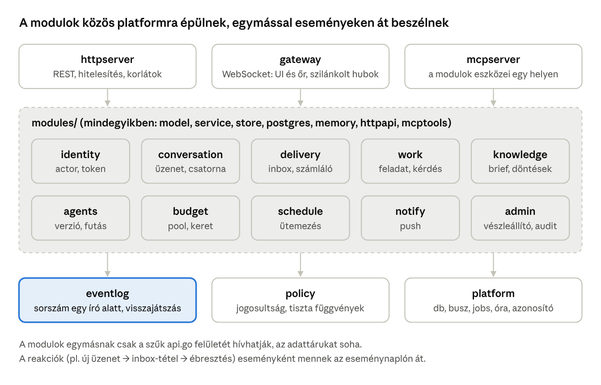

# Tanulságok nyílt forrású chat szerverekből

Oct 15, 2026

## Összefoglaló

Öt működő, nyílt forrású chat szerver forráskódját néztem át (Mattermost, Dendrite, Synapse, Zulip, Stoat/Revolt). A kódot nem másoljuk, csak a bevált megoldásaikat vesszük át. A legfontosabb tanulság: a kódot **funkciók (modulok) szerint** érdemes szervezni, a rétegeket pedig a modulokon belül tartani. Ez az eddigi „egy nagy domain, egy nagy app” felosztásunkat változtatja meg.

**Amit átveszünk (10 döntés):**

1.  **Modulonkénti szerkezet** (Dendrite, Stoat): conversation, delivery, work, knowledge, agents, budget stb. Mindegyikben saját modell, szolgáltatás, adattár-interfész, Postgres- és memóriabeli megvalósítás, valamint HTTP/MCP réteg.

2.  **Memóriabeli „referencia” adattár minden modulhoz** (Stoat), és **közös adattár-tesztkészlet**, ami mindkét megvalósításon lefut (Mattermost storetest).

3.  **Rendezőkre épülő adattár-rétegek** (Mattermost): a mérés, az újrapróbálás és később a gyorsítótár külön burokként kerül az adattár köré, nem a lekérdezésekbe.

4.  **Címzettenkénti kézbesítési sor jelzőbitekkel** (Zulip UserMessage): az inbox egy sor címzettenként és tételenként (olvasott, megemlített, ébreszt, nyugtázott), részleges indexekkel.

5.  **Olcsó olvasatlan-számlálók** (Mattermost): a csatorna összesüzenet-száma és a tag utolsó látott száma, nem számolás lekérdezéssel.

6.  **Az értesítő csak pozíciót küld, az adat mindig az adatbázisból jön** (Dendrite notifier). Így nincs versenyhelyzet és nincs elveszett esemény.

7.  **Egy író eseményfolyamonként** (Synapse stream writers): az eseménysorszám kiosztása egy tranzakciós zár alatt történik, különben a sorszámok nem a commit sorrendjében látszódnának.

8.  **Kliens által adott üzenet-azonosító az idempotens küldéshez** (Mattermost PendingPostId).

9.  **Felhasználó szerint szilánkolt WebSocket hubok** (Mattermost): több hub, a felhasználó azonosítójának hash-e dönti el, melyikre kerül.

10. **Beágyazható eseménybusz** (Dendrite beágyazott NATS): egyfolyamatos módban memórián belül, több gépen külső buszon, ugyanazzal a kóddal.

**Amit nem veszünk át:** a Matrix föderációs és állapotfeloldási bonyolultságát, a Zulip long-polling eseménysorát (mi WebSocketet használunk), a Stoat mikroszolgáltatásokra bontását induláskor (nálunk egy bináris, szerepkörökkel), és a MongoDB-t.

**Mi változik a tervben:** a könyvtárszerkezet modulokra vált; az inbox_item helyett delivery tábla jön jelzőbitekkel; olvasatlan-számlálók kerülnek a csatornába és a tagságba; a fájl két táblára válik (tartalom és hivatkozás); a fogyasztók a saját pozíciójukat tárolják; a gépelés- és jelenlétjelzések nem kerülnek az eseménynaplóba. A részletek az utolsó fejezetekben.

## Vizsgált projektek

Mind az öt projekt aktív, és élesben, sok felhasználóval fut. Mindegyikből a 2026. október 15-i állapotot néztem meg a GitHubon: könyvtárszerkezet, adattár-interfészek, modellek, WebSocket és eseménykezelés.

| Projekt                                                 | Nyelv           | Licenc                                 | Fájlok     | Miért néztem                                                                     |
|---------------------------------------------------------|-----------------|----------------------------------------|------------|----------------------------------------------------------------------------------|
| [Mattermost](https://github.com/mattermost/mattermost)  | Go + React      | AGPL-3.0 (szerver), részben Apache-2.0 | kb. 16 300 | Go-ban írt, éles Slack-alternatíva: rétegek, adattár, WebSocket                  |
| [Dendrite](https://github.com/element-hq/dendrite)      | Go              | AGPL-3.0                               | kb. 850    | Go-ban írt Matrix szerver: komponensek, eseménybusz, sync                        |
| [Synapse](https://github.com/element-hq/synapse)        | Python (+ Rust) | AGPL-3.0                               | kb. 2 000  | A Matrix referencia-szervere: eseményfolyamok, worker-skálázás                   |
| [Zulip](https://github.com/zulip/zulip)                 | Python (Django) | Apache-2.0                             | kb. 9 000  | Kiforrott adatmodell: címzettenkénti üzenet-állapot, eseménysor                  |
| [Stoat / Revolt](https://github.com/revoltchat/backend) | Rust            | AGPL-3.0                               | kb. 650    | Tiszta modulfelosztás, memóriabeli referencia-adatbázis, szolgáltatásokra bontás |

## Mattermost (Go)

Klasszikus háromrétegű Go szerver: vékony HTTP-kezelők, egy nagy alkalmazási réteg és egy rétegzett adattár. A legtöbbet az adattár-rétegekből és a WebSocket-kezelésből lehet tanulni.

**Szerkezet (server/):**

server/  
channels/  
api4/ \# REST kezelők (vékonyak)  
app/ \# üzleti logika; platform/ alatt a WebSocket hub  
store/ \# adattár: interfész + rétegek (lásd lent)  
jobs/ \# háttérfeladatok  
wsapi/ \# WebSocket-üzenetek kezelése  
db/ \# migrációk  
public/  
model/ \# megosztott modellek (Post, Channel, ChannelMember…)  
plugin/ \# plugin API  
i18n/ \# szerveroldali fordítások  
einterfaces/ \# interfészek a fizetős funkciókhoz

**Adattár-rétegek (rendező minta).** Egyetlen Store interfész van, entitásonként al-interfészekkel (Post(), Channel() stb.). A tényleges SQL kóré burkok kerülnek, egymásra épülve: időmérő → újrapróbáló (holtpontnál) → helyi gyorsítótár → keresőindex → SQL. A burkok kódját generátor írja (layer_generators), ezért egy új metódus nem jár kézi munkával. Egy közös tesztkészlet (storetest, kb. 130 fájl) minden adattár-metódust tesztel.

**WebSocket hub.** Több hub fut párhuzamosan, a felhasználó azonosítójának hash-e dönti el, melyikre kerül a kapcsolat. A szétküldési sor 4096 elemű. „Megbízható WebSocket” módban minden kapcsolatnak azonosítója és sorszáma van, és az utolsó 128 esemény egy „halott sorban” marad. Újracsatlakozáskor ebből vesztésmentesen pótol, de csak ugyanazon a szerverpéldányon.

**Modellek, amik tanulságosak:**

- Post.PendingPostId: a kliens adja az azonosítót küldéskor, így egy újraküldött üzenet nem duplikálódik.

- Post.OriginalId, EditAt: a szerkesztés előzménye külön sorokban marad meg.

- Post.RootId: egyszintű thread a gyökérüzenetre mutatva.

- ChannelMember.MsgCount, MentionCount, LastViewedAt: az olvasatlan-jelzés számlálókból jön (a csatorna összesüzenet-száma mínusz a tag által látott), nem lekérdezésből.

**Amit átveszünk:** a rendező-rétegeket (elsőnek mérés és nyomkövetés), a közös adattár-teszteket, a szilánkolt hubot, a kliensoldali üzenet-azonosítót és a számlálós olvasatlan-jelzést. **Amit nem:** az egyetlen óriási app csomagot. Ez a Mattermostban több száz fájl, és nálunk pont ezt váltja ki a modulokra bontás.

## Dendrite (Go, Matrix)

A Dendrite a legjobb Go-s minta a modulokra bontásra. Minden funkcióterület („komponens”) ugyanazt a belső szerkezetet követi, és a komponensek egy eseménybuszon keresztül beszélnek.

**Szerkezet:**

clientapi/ roomserver/ syncapi/ userapi/ federationapi/ mediaapi/ …  
api/ \# a komponens nyilvános interfésze (más komponensek ezt hívják)  
internal/ \# megvalósítás  
storage/  
interface.go  
tables/ \# táblánkénti interfészek  
shared/ \# adatbázistól független logika  
postgres/ \# Postgres megvalósítás, saját migrációkkal (deltas/)  
sqlite3/ \# SQLite megvalósítás  
producers/ \# eseményt küld a buszra  
consumers/ \# eseményt fogad a buszról  
routing/ \# HTTP végpontok  
setup/jetstream/ \# eseménybusz: beágyazott NATS szerver

**Beágyazott eseménybusz.** Egyfolyamatos módban a Dendrite saját magán belül indít egy NATS JetStream szervert (fájlba vagy memóriába ír). Több gépes módban ugyanaz a kód egy külső NATS-hoz csatlakozik. A folyamok nevei konstansok (OutputRoomEvent, OutputReceiptEvent, OutputTypingEvent …), megőrzési szabállyal.

**Sync: pozíciók és értesítő.** A kliens egy többrészes tokent kap (üzenetfolyam-pozíció, gépelés-pozíció, olvasási nyugta pozíciója stb.). Minden folyamnak saját „szolgáltatója” van, két művelettel: teljes szinkron és növekményes szinkron két pozíció között. Az értesítő (Notifier) a várakozó klienseket csak felébreszti az új pozícióval, az adatot nem adja át. A kód megjegyzése szerint ez azért van, hogy ne legyen versenyhelyzet: ha az eseményt adná át, a token közben továbbléphetne, és esemény veszne el.

**Amit átveszünk:** a komponensenkénti egységes belső szerkezetet (api, megvalósítás, adattár több háttérrel, eseményküldők és -fogadók); a „csak pozíciót értesítünk” elvet; a folyamonkénti pozíciót (a mi esetben: tartós események külön, ideiglenes jelzések külön); és a beágyazható busz ötletét.

## Synapse (Python, Matrix)

A Synapse a skálázásról tanít a legtöbbet: egy fő folyamatból indult, és fokozatosan bontották „workerekre” anélkül, hogy a kódot szétszedték volna. Ez ugyanaz az út, amit mi a szerepkörökkel tervezünk.

**Rétegek (synapse/):** rest/ (végpontok) → handlers/ (üzleti logika) → storage/ (adattár, témánkénti „store” osztályokból összerakva); mellette replication/ (folyamatok közti adatáramlás), streams/, push/, app/ (az egyes worker-típusok belépési pontjai).

**Workerek:** ugyanaz a kód különböző szerepkörben fut (generic_worker, pusher, federation_sender, media_repository, háttérfeladat-worker). A folyamatok Redis pub/sub-on keresztül kapják meg egymás friss adatfolyamait („replikáció”), és HTTP-n kérnek, ha válasz kell. A háttérfeladatok egyetlen kijelölt workeren futnak (run_background_tasks_on).

**„Stream writers” – a legfontosabb tanulság.** Egy adatfolyamot (pl. események) alapból csak egy folyamat írhat. Ennek oka: ha több író oszt sorszámot, a sorszámok nem a commit sorrendjében válnak láthatóvá. Egy olvasó láthatja a 101-es eseményt, miközben a 100-as még nincs commitolva, és ha ekkor továbblép 101-re, a 100-ast soha nem kapja meg. Több íróhoz a Synapse külön „meddig biztosan perzisztált” pozíciót követ.

**Következmény a mi tervünkre:** az eddigi tervünkben az event.seq egy Postgres bigserial volt, több api példánnyal. Ez pontosan ebbe a hibába futna bele. Megoldás: a sorszámot egy tranzakciós advisory lock alatt osztjuk ki, így az eseményírás sorrendje és a commit sorrendje azonos. A mi méretünknél (másodpercenként legfeljebb néhány tucat esemény) ez nem szűk keresztmetszet. Ha egyszer az lesz, a Synapse-féle „biztosan perzisztált pozíció” a következő lépés.

**Amit átveszünk:** a szerepkörös worker-modellt (már a terv része volt, ez megerősíti), az egy írós eseményfolyamot, és azt, hogy a háttérfeladatok kijelölt példányon fussanak.

## Zulip (Python)

A Zulip adatmodellje a legkiforrottabb az öt közül, különösen abban, hogyan tudja egy felhasználóról gyorsan, mit olvasott és mi szólt neki.

**Szerkezet (zerver/):** models/ (témánként egy fájl: messages, streams, users …), actions/ (minden állapotváltozás egy do\_\* függvény, ami az eseményt is kiküldi), views/ (végpontok), lib/, tornado/ (eseménysor), worker/ (sorfeldolgozók feladattípusonként: e-mail, push, link-előnézet, kimenő webhook …), openapi/ (az API leírása).

**Message + UserMessage.** Az üzenet egyszer tárolódik, és minden címzettnek van egy UserMessage sora egy bitmezővel: read, starred, mentioned, group_mentioned, has_alert_word, historical, is_private, active_mobile_push_notification stb. A gyakori kérdésekre (olvasatlan, megemlített, csillagozott) **részleges indexek** vannak, pl. csak azokra a sorokra, ahol a read bit 0. Egy felhasználó olvasatlan megemlítései így egyetlen, kicsi indexből jönnek.

**Eseménysor.** Minden kliens kap egy saját sort, last_event_id-vel, és ebből kéri a következő eseményeket. A tétlen sorokat a szerver idővel törli. Az azonos típusú frissítéseket (pl. sok „olvasott” jelzés) egy „virtuális eseménybe” vonja össze, hogy egy lassú kliens ne kapjon ezreket.

**Amit átveszünk:**

- A címzettenkénti sort jelzőbitekkel és részleges indexekkel: ez lesz a mi delivery táblánk (az eddigi inbox_item helyett).

- Az actions mintát: minden állapotváltozás egy használati eseten megy át, ami ugyanabban a tranzakcióban az eseményt is megírja. Ez a mi tervben is így volt; a Zulip megerősíti.

- Az összevonható eseményeket (olvasott-jelzések, számlálók) lassú kliensnél.

- Feladattípusonkénti worker-sorokat (push, digest, előnézet, API-agent), a River sorneveivel.

**Amit nem:** a long-polling eseménysort (mi WebSocketet használunk, sorszámos visszajátszással), és a bitmezőt mint egyetlen egész számot: Postgresben egy smallint bitmaszk is jó, de a jelzők egy részét (pl. nyugtázva, mikor) időbélyeggel tároljuk.

## Stoat / Revolt (Rust)

A Stoat (korábban Revolt) a legtisztábban bontja a kódot: közös alapkönyvtárak és külön futtatható szolgáltatások.

**Szerkezet (crates/):**

core/config core/database core/files core/models core/permissions core/presence core/result core/coalesced  
delta \# REST API szerver  
bonfire \# WebSocket eseményszerver  
services/autumn \# fájlszerver  
services/january \# link-előnézet proxy  
daemons/crond \# időzített takarítás  
daemons/pushd \# push értesítések

**Entitásonkénti mappa a core/database-ben:** models/messages/ alatt model.rs (az adatszerkezet), ops.rs (az adattár-interfész, Rust trait), ops/mongodb.rs (éles megvalósítás) és ops/reference.rs (memóriabeli megvalósítás tesztekhez). Az adatbázis-kapcsolódás egy kapcsolóval választható a valódi és a referencia között.

**Külön jogosultság-modul** (core/permissions): a jogok kiszámítása tiszta függvény, adatbázis nélkül, és minden szolgáltatás ezt használja.

**További ötletek:** channel_unreads modell (csatornánként utolsó olvasott azonosító + megemlítések), file_hashes külön a files-tól (ugyanaz a tartalom egyszer tárolódik), ratelimit_events mint saját modell, coalesced (az egyidejű, azonos lekérdezések összevonása).

**Amit átveszünk:** az entitásonkénti „modell + adattár-interfész + éles + referencia” négyest; a külön, tiszta jogosultság-csomagot; a fájl két táblára bontását. **Amit nem:** a külön binárisokat induláskor. Mi egy binárist futtatunk szerepkörökkel, ami a Stoat felosztásának egyszerűbb változata (api ≈ delta, gateway ≈ bonfire, worker ≈ pushd + january + autumn, scheduler ≈ crond).

## Témánkénti összehasonlítás és döntés

Minden sorban: hogyan oldják meg a vizsgált projektek, és mit csinál ebből a Colonyhall.

| Téma                                | Hogyan csinálják                                                                                                                          | Colonyhall döntés                                                                                                                 |
|-------------------------------------|-------------------------------------------------------------------------------------------------------------------------------------------|-----------------------------------------------------------------------------------------------------------------------------------|
| Kódszervezés                        | Mattermost: rétegek szerint (api4 / app / store). Dendrite és Stoat: funkcióterületek szerint, belül rétegekkel.                          | Modulok szerint, minden modulon belül ugyanaz a rétegzés.                                                                         |
| Adattár                             | Mattermost: egy interfész, rendező-rétegek. Dendrite: táblánkénti interfész, több háttér. Stoat: entitásonkénti trait, éles + referencia. | Modulonkénti Store interfész, Postgres + memóriabeli megvalósítás, közös szerződésteszt; mérés és nyomkövetés generált burokkal.  |
| Üzleti logika                       | Zulip: actions/do\_\*. Synapse: handlers/. Mattermost: app/.                                                                              | Modulonkénti Service, metódusonként egy használati eset, ami az eseményt is megírja.                                              |
| Olvasatlan és „nekem szól”          | Zulip: címzettenkénti sor bitmezővel, részleges indexek. Mattermost és Stoat: csatorna-tag számlálók.                                     | Mindkettő: delivery (címzettenkénti sor jelzőkkel) az agentek inboxa és a megemlítések számára; számlálók a csatornajelvényekhez. |
| Események sorszáma                  | Synapse: egy író folyamonként, különben „biztosan perzisztált pozíció”. Dendrite: folyamonkénti pozíció.                                  | Egy tartós eseményfolyam, sorszám advisory lock alatt; az ideiglenes jelzések (gépel, jelen van) külön, sorszám nélkül.           |
| Értesítés és valós idejű kézbesítés | Dendrite: az értesítő csak pozíciót ad. Mattermost: szilánkolt hubok, kapcsolatonkénti sorszám.                                           | A buszon csak a sorszám megy, a gateway az adatbázisból olvas; hubok felhasználó-hash szerint szilánkolva.                        |
| Újracsatlakozás                     | Mattermost: 128 elemű puffer, csak ugyanazon a példányon. Zulip: kliensenkénti sor last_event_id-vel.                                     | last_seq-től visszajátszás az eseménytáblából, bármelyik példányon működik; túl régi pozíciónál teljes újratöltés.                |
| Idempotens küldés                   | Mattermost: PendingPostId.                                                                                                                | client_msg_id, egyedi szerzőnként; újraküldésnél a meglévő üzenet jön vissza.                                                     |
| Szerkesztési előzmény               | Mattermost: új sor OriginalId-vel.                                                                                                        | Külön message_revision tábla (tisztább, a terv már így szólt).                                                                    |
| Eseménybusz                         | Dendrite: beágyazott vagy külső NATS. Synapse: Redis pub/sub + HTTP.                                                                      | EventBus port: egyfolyamatos módban memórián belüli, több folyamatnál Postgres NOTIFY, nagyobb méretnél NATS.                     |
| Háttérfeladatok                     | Zulip: feladattípusonkénti sorfeldolgozók. Synapse: kijelölt worker. Stoat: külön démonok.                                                | River, feladattípusonkénti sornevekkel (push, digest, preview, api_agent, maintenance); a worker szerepkör sorokat választhat.    |
| Fogyasztók pozíciója                | Dendrite: tartós NATS-fogyasztók. Synapse: pozíciótáblák.                                                                                 | consumer_offset tábla: minden belső fogyasztó (ébresztő, push, digest) tárolja, meddig dolgozta fel az eseményeket.               |
| Jogosultság                         | Stoat: külön, tiszta jogosultság-csomag.                                                                                                  | internal/policy csomag, tiszta függvényekkel; minden modul ezt hívja.                                                             |
| Fájlok                              | Stoat: tartalom-hash külön táblában. Zulip: Attachment az üzenetekhez kötve.                                                              | blob (tartalom, hash szerint egyszer) + file (hivatkozás csatornához, üzenethez).                                                 |
| API-leírás                          | Zulip: openapi/ a kód mellett, tesztek ellenőrzik.                                                                                        | api/openapi.yaml, a tesztek ellenőrzik, hogy a válaszok megfelelnek-e neki.                                                       |
| Szerveroldali fordítás              | Mattermost: i18n/ a szerverben.                                                                                                           | A rendszerüzenetek eseményként tárolódnak, a kliens fordítja; a szerverben csak a push és az e-mail szövegei vannak fordítva.     |

## Módosított rétegek és könyvtárszerkezet

A hexagonális elv marad (a domain nem függ semmitől, minden I/O cserélhető adapter), de **funkciónkénti modulokban**, nem egyetlen nagy domain és app csomagban. A Dendrite komponensei és a Stoat crate-jei is így épülnek; így egy új funkció egy új modul, egy meglévő funkció változása pedig egy mappa.

Colonyhall modulok · transzportok, 10 modul, közös platform

Három szint van: felül a transzportok (HTTP, WebSocket, MCP), középen a 10 modul, alul a közös részek (eseménynapló, jogosultság, platform).

**Könyvtárszerkezet:**

colonyhall/  
cmd/  
colonyhall/ \# szerver; COLONY_ROLE: api \| gateway \| worker \| scheduler \| all  
colony/ \# CLI és colony-guard  
fake-agent/ \# determinisztikus tesztagent  
internal/  
platform/ \# közös infrastruktúra, üzleti logika nélkül  
config/ log/ metrics/ tracing/  
db/ \# pgx pool, tranzakció-segéd, advisory lock  
clock/ ids/ \# Clock és IDGenerator: éles és teszt-megvalósítás  
bus/ \# EventBus port: inproc/, pgnotify/, nats/  
jobs/ \# River beállítás, sornevek  
policy/ \# jogosultság-számítás, tiszta függvények (Stoat permissions)  
eventlog/ \# eseményírás egy íróval, visszajátszás, consumer_offset  
modules/  
identity/ \# actor, munkamenet, passkey, agent token  
conversation/ \# csatorna, tag, üzenet, revízió, reakció, fájl, link-előnézet  
delivery/ \# delivery (inbox), olvasatlan-számlálók, ébresztési döntés, digest  
work/ \# feladat, kérdés, jóváhagyás, foglalás  
knowledge/ \# brief, tudásbejegyzés, döntés, jegyzetfüzet  
agents/ \# agentcsalád és -verzió, gép, munkamenet, futás, worktree  
budget/ \# pool, keretmérés, küszöbök  
schedule/ \# ütemezés, futás  
notify/ \# push feliratkozás, értesítési szabályok  
admin/ \# vészleállító, audit, állapot  
httpserver/ \# router, middleware (hitelesítés, CSRF, korlátok, problem+json)  
gateway/ \# WebSocket hubok felhasználó-hash szerint (UI és őr)  
mcpserver/ \# a modulok MCP eszközeinek regisztrálása  
storetest/ \# közös adattár-tesztek (Mattermost storetest)  
guard/ \# kliensoldal: clients/, pty/, usage/  
migrations/ \# goose SQL migrációk  
api/openapi.yaml  
web/ \# React + Vite + TypeScript PWA

**Egy modul belülről** (példa: conversation):

modules/conversation/  
model.go \# Channel, Member, Message, Revision, Reaction és szabályaik (domain)  
events.go \# MessageCreated, MessageEdited, ReactionAdded …  
service.go \# Service: SendMessage, EditMessage, React … (használati esetek)  
store.go \# Store interfész (port)  
api.go \# szűk felület más moduloknak (pl. GetMessageSummary)  
postgres/ \# Store megvalósítás (sqlc: queries.sql → generált kód)  
memory/ \# referencia-megvalósítás tesztekhez (Stoat reference)  
httpapi/ \# REST kezelők  
mcptools/ \# MCP eszközök (send, read, react)  
service_test.go \# tesztek a memóriabeli adattárral

**Szabályok (a golangci-lint depguard ellenőrzi):**

1.  Egy modul importálhatja a platform, a policy, az eventlog csomagot, és más modulok **csak** api.go felületét (Go-ban: a modul gyökércsomagjának exportált interfészeit). Másik modul postgres/, memory/, httpapi/ csomagját soha.

2.  A modulok közti reakció eseménnyel történik: a delivery feliratkozik a conversation.MessageCreated eseményre, nem a conversation hívja a delivery-t. Így egy új modul anélkül reagálhat, hogy a meglévőket módosítani kellene.

3.  A model.go és az events.go csak a Go standard könyvtárat használja; a service.go a portokon keresztül éri el a külvilágot.

4.  Minden Store interfészre ugyanaz a storetest készlet fut a memory és a postgres megvalósításon.

5.  A mérés és a nyomkövetés generált burokként kerül az adattárak kéré (go generate), nem kézzel minden metódusba.

**Mi változik a Műszaki specifikációhoz képest:** az internal/domain, internal/app, internal/adapters helyett internal/modules/\<modul\>/ saját rétegekkel. A külső szolgáltatások adapterei (AI-szolgáltatók, git, tárhely, push) annak a modulnak a mappájába kerülnek, amelyik használja őket, vagy a platform alá, ha több modul is.

## Módosított adatmodell

A Műszaki specifikáció adatmodellje nagyrészt marad. Ezek a változások következnek a tanulságokból:

| Változás             | Előtte                                      | Utána                                                                                                                                                                                                                                                                                                  | Honnan                               |
|----------------------|---------------------------------------------|--------------------------------------------------------------------------------------------------------------------------------------------------------------------------------------------------------------------------------------------------------------------------------------------------------|--------------------------------------|
| Inbox                | inbox_item (címzett, esemény, ok, állapot)  | delivery: recipient_id, item_kind (message / task / question / answer / admin / schedule), item_id, channel_id, flags bitmaszk (unread, mentioned, wake, dm, reaction_down), acked_at, run_id; egyedi kulcs (recipient_id, item_kind, item_id); részleges index az olvasatlan és az ébresztő tételekre | Zulip UserMessage                    |
| Olvasatlan-jelvények | channel_member.last_read_seq                | \+ channel.msg_count, channel_member.msg_count, channel_member.mention_count; az olvasatlan szám = különbség                                                                                                                                                                                           | Mattermost ChannelMember             |
| Üzenet               | id, channel, thread, author, kind, body …   | \+ client_msg_id (egyedi szerzőnként), + reply_count, last_reply_at a thread-gyökéren                                                                                                                                                                                                                  | Mattermost PendingPostId, ReplyCount |
| Esemény              | seq bigserial                               | seq advisory lock alatt kiosztva (egy író); + stream mező (egyelőre mindig main)                                                                                                                                                                                                                       | Synapse stream writers               |
| Ideiglenes jelzések  | nem volt külön                              | Gépelés, jelenlét, „agent dolgozik”: nem kerülnek az event táblába, csak a buszon mennek, sorszám nélkül                                                                                                                                                                                               | Dendrite külön folyamai              |
| Fogyasztók           | nem volt                                    | consumer_offset (consumer_name, last_seq, updated_at)                                                                                                                                                                                                                                                  | Synapse, Dendrite                    |
| Fájl                 | file (hash, méret, tárolókulcs, csatorna …) | blob (sha256, size, mime, storage_key) + file (blob_id, channel_id, message_id, name, uploaded_by)                                                                                                                                                                                                     | Stoat file_hashes                    |
| Sebességkorlát       | csak memóriában                             | rate_limit_event (actor, kind, at) a többpéldányos és auditolható korlátokhoz                                                                                                                                                                                                                          | Stoat ratelimit_events               |

**Ami nem változik:** a munkaterület mindenhol, az actor közös tábla, az append-only elv, a tranzakciós outbox, a message_revision, a feladat, kérdés, tudás, keret és ütemezés táblái.

## Licenc és források

A vizsgált projektekből **ötleteket és mintákat veszünk át, kódot nem.** A Mattermost szervere, a Dendrite, a Synapse és a Stoat AGPL-3.0 licencű. Ha ezekből kódot másolnánk, a Colonyhallnak is AGPL-nek kellene lennie, pedig a licencről még nem döntöttünk. A Zulip Apache-2.0 licencű: abból a kód is átvehető lenne a szerzői jogi megjegyzés megtartásával, de erre sincs szükség. Az architektúrai minták (rétegek, táblaszerkezet, protokoll-ötletek) nem állnak szerzői jogi védelem alatt.

**Szabály a fejlesztéshez:** a Colonyhall kódjába nem kerül beillesztés ezekből a repókból. Ha egy megoldást onnan veszünk, a kódkomment a mintára hivatkozik (pl. „Zulip UserMessage-style flags”), nem másolt sorokra.

**Források (a 2026-10-15-i állapot):**

- Mattermost: [repo](https://github.com/mattermost/mattermost), különösen server/channels/store/doc.go, server/channels/app/platform/web_hub.go, web_conn.go, server/public/model/post.go, channel_member.go

- Dendrite: [repo](https://github.com/element-hq/dendrite), különösen syncapi/streams/streamprovider.go, syncapi/notifier/notifier.go, setup/jetstream/

- Synapse: [repo](https://github.com/element-hq/synapse), különösen docs/workers.md („Stream writers”, „Background tasks”)

- Zulip: [repo](https://github.com/zulip/zulip), különösen zerver/models/messages.py (UserMessage), zerver/tornado/event_queue.py

- Stoat / Revolt: [repo](https://github.com/revoltchat/backend), különösen README.md (crate-lista), crates/core/database/src/drivers/mod.rs, models/messages/
